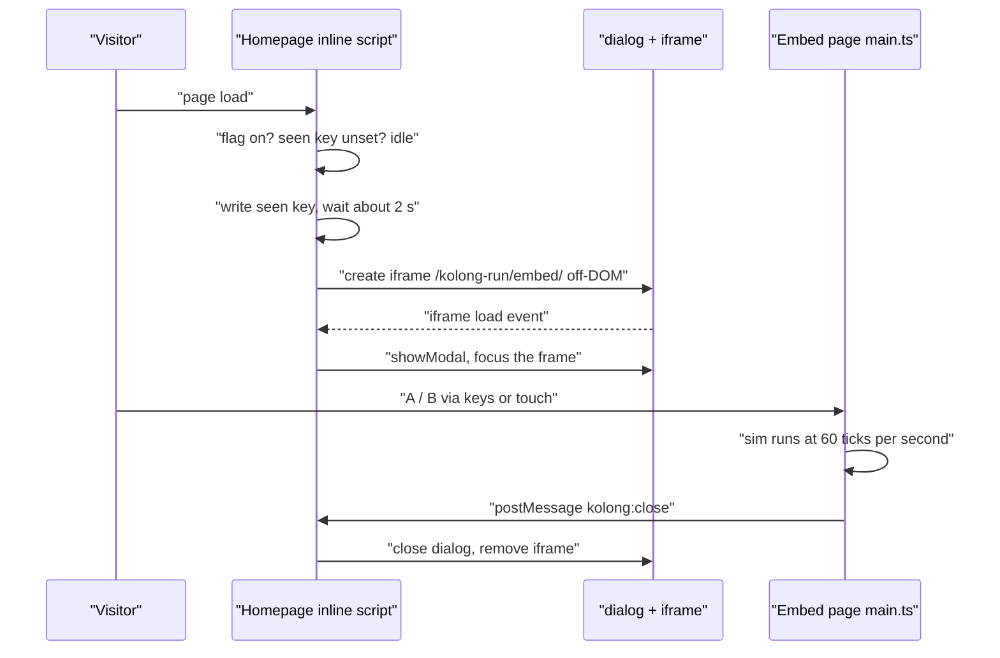

# TRD: Kolong Run

**Status:** Implemented through M4 (popup built, flag off in production). Revision 2 below lists what differs from the text.

**Date:** 2026-11-06

**Implements:** `docs/prd-kolong-run.md` (revision 1).

**Revision 2 (2026-11-06).** Built. Where the text below disagrees with this block, this block wins.

- Phones play in portrait, so the playfield stays 176 by 96 but the canvas grows taller (up to 220 logical px) and the extra headroom is drawn above the playfield. Simulation coordinates are unchanged. Scale is `floor(min(width / 176, height / 96))`.
- Jump tuning changed after the first visual check (a pop from a kicker reached the flyover deck): `GRAVITY` 0.06, pop apex 12, 20, 28 px, ride-launch cap -2.0 px/tick, `T_LOW` 40. Flat-ground airtime is 40, 52 and 61 ticks. Measured airtime off ramps is 70 to 76 ticks (kicker 72, bank 70, pyramid 69, quarter 75, bowl 70). The air-budget table above was the earlier estimate: one tap fits a low ollie, two taps a mid ollie, three taps a high ollie or any ramp, four taps a ramp with margin of a few ticks (sketchy window).
- Stairs are a pit with steps dropping 4 px each and a wall at the end (depth 12 to 20 px, so it fits the ground band), not rects.
- The popup iframe is appended inside the closed dialog (an iframe must be in the document to load) and the dialog opens on its `load` event.
- `PUBLIC_KOLONG_POPUP=false` in `.env.production`. The routes are live; the popup is off until the owner flips the flag.
- Not built: grabs, manual pad, low beam, time-of-day palette, share card, daily seed, ghost skaters. The grind style (button held while grinding) is built.

**Revision 3 (2026-11-06).** Owner design feedback applied after playing it.

- Rider: drawn as a jointed pixel figure (about 36 px tall, `src/lib/game/figure.ts`) with a 28 px board, replacing the 14 px sprite and `sprites.ts`. Both tilt to any angle, so the board and rider follow kicker, bank, quarter and stair-ramp slopes (board at the full slope angle, rider at 0.7 of it). An ollie snaps the tail down first (a nollie, the nose) then levels out; in the air the board follows the flight path. Tricks show the board's spin (foreshortening and a yellow nose marker), flip (thickness and the deck colour swapping) and ghost trails.
- Background cut back to flat greys (wall band, pillars, deck) so the rider and tricks carry the detail. Colour stays on the rider, board and obstacles: a measured `drawFrame` costs 0.08 ms of a 16.7 ms frame, and forcing every fill to grey did not make it faster, so grey would not improve performance.
- Rails: touching down on a rail starts a window of 8 ticks before to 6 ticks after touchdown. Holding A is a manual, holding B a nose manual (board tilts 28 degrees about the rear or front wheel). No press in the window ends the run (`deadReason: 'miss'`, shown as "Kepleset"/"Slipped"). Releasing the held button pops off at mid height. Ledges are unchanged: landing on one is a safe auto slide.
- Stairs are now a ramp up to a deck followed by steps down to the flat; the bowl is a ramp up to a deck, a drop-in, a floor and the far wall. Nothing goes below ground, and rolling down stairs is safe. Measured airtime off stairs is 73 to 78 ticks, off the bowl 76.
- Spacing: `REACT_TICKS` 34 and a 40 to 140 px random extra per gap, so about one obstacle is on screen at a time. The first obstacle is at 260 px.
- Canvas is at least 128 logical px tall (`MIN_CANVAS_H`), so the taller rider has headroom on desktop too.
- The "Cara main" how-to-play section is removed; the in-game hints stay (jump, tap in the air, and a rail hint until the first manual).

Evidence markers used throughout:

- **[V]** verified in this repo or by a command I ran, source given.
- **[A]** assumption or tunable number, to be settled in the M0 feel spike and playtests.
- **[E]** estimate derived from the constants in this document, not measured.

## Overview

Kolong Run is a client-only canvas game inside the existing static Astro site. The game is a pure, tick-based simulation (no DOM, no wall clock) driven by a thin input layer and drawn by a separate renderer at 176 by 96 logical pixels. Two static routes expose it: a standalone page and an embed page used by a feature-flagged first-visit popup on the homepage. There is no backend, no new dependency, no image assets and no audio.

## Scope

- In scope: routes, layout changes, game engine, rendering, input, popup, i18n, storage, tests, CI step.
- Out of scope: sound, analytics events, server changes, leaderboard, SOTM skins (all decided out in the PRD, section 14).

## Deviations from the PRD

The PRD is updated to match this table in the same change.

| # | PRD said | TRD does | Why |
|---|---|---|---|
| D1 | Embed mode is `?embed=1` on the same page, with `Base.astro` skipping chrome | A sibling static route `/kolong-run/embed/` built with a `bare` layout | The site is `output: 'static'` [V: `astro.config.mjs`], so a query string is unknown at build time. A query-driven layout would need a script that hides the header after parse. A separate route is deterministic and has no flash. |
| D2 | Popup component with a scripted `<script>` | Popup markup and an `is:inline` script rendered only when the flag is on | I did not verify whether Astro ships a component's bundled `<script>` when its markup is rendered conditionally [A]. `is:inline` scripts live where they are placed, so flag-off is guaranteed. Precedent: `is:inline` in `Base.astro` and `index.astro` [V]. |
| D3 | Combo gap 200 ms, tap 160 ms, trick animation 0.35 to 0.7 s | Gap 9 ticks (150 ms), tap 10 ticks (167 ms), animation 16 to 28 ticks (0.27 to 0.47 s) | The PRD air-budget estimate ignored the wait for the combo gap and the animation time. With the PRD numbers a two-tap trick does not fit in the highest flat ollie. See "Air budget". |
| D4 | Speed 70 to 170 px/s | 70 to 140 px/s as the starting cap, tunable 120 to 170 | At 170 px/s the 176 px viewport shows 62 ticks of lookahead, barely more than a full 21-tick hold plus a low ollie arc (55 ticks). See "Level generation and fairness". |
| D5 | Grind: "release or tap pops off, tap picks style" | Grind style is the button held while grinding; release pops off | A tap cannot both change style and pop off. |
| D6 | `Esc` pauses in the game | `Esc` pauses on the standalone page and closes the popup on the embed page via `postMessage` | Keys inside an iframe do not reach the parent dialog's own Esc handling reliably [A], so the embed page asks the parent to close. |

## Design

### Routes and build output

All routes are directories because the site uses `trailingSlash: 'always'` [V].

| Route | File | Layout | Purpose |
|---|---|---|---|
| `/kolong-run/`, `/en/kolong-run/` | `src/pages/[...lang]/kolong-run/index.astro` | `Base` with site header and footer | Standalone hidden route, always built, used for testing |
| `/kolong-run/embed/`, `/en/kolong-run/embed/` | `src/pages/[...lang]/kolong-run/embed.astro` | `Base` with `bare` | Loaded by the popup iframe, always built |

Both use `getStaticPaths()` returning `localeRoutes()` and `routeLang(Astro.params.lang)`, as `support.astro` does [V]. Both render one shared component, `src/components/KolongGame.astro`, with an `embed` prop. Nested route directories are already used (`journal/index.astro` [V]).

`Base.astro` gets three optional props, none of which changes existing pages:

| Prop | Effect |
|---|---|
| `noindex` | Emits `<meta name="robots" content="noindex,nofollow">` in `<head>`. Both game routes pass it. |
| `bare` | Skips the `<header class="site-header">` and `<footer class="site-footer">` blocks. The embed route passes it. |
| `bodyClass` | Adds a class to `<body>`. Both game routes pass `kolong-page`, which hides the grain overlay. |

Hidden means: neither route is added to the `nav` array or to `staticPaths` in `sitemap.xml.ts` [V: both are hard-coded arrays], and `robots.txt` is not changed [V: it allows all and links the sitemap].

The game routes load the existing global stylesheet. Game styles are scoped inside `KolongGame.astro` and `KolongPopup.astro`. The grain overlay is `body::after` at `z-index: 200` with a multiply blend [V: `global.css`], so `body.kolong-page::after { display: none }` is required or the pixels are blurred.

### Module layout

Helpers live under `src/lib/game/`, following `src/lib/` as the home for non-component code [V]. Imports inside the game folder use explicit `.ts` extensions so the files run under Node's type stripping. `allowImportingTsExtensions` is already on in Astro's base tsconfig [V: `node_modules/astro/tsconfigs/base.json`], and `verbatimModuleSyntax` is on [V], so type-only imports must use `import type`.

Constraint for every file under `src/lib/game/` except `render.ts`, `font.ts`, `sprites.ts` and `main.ts`: no DOM, no `window`, no `performance.now()`, no `Math.random()`, no `Date`. Only plain data and pure functions.

| File | Responsibility | DOM |
|---|---|---|
| `consts.ts` | Tick constants, physics constants, layout constants | No |
| `rng.ts` | Seeded PRNG (mulberry32) | No |
| `tricks.ts` | Trick table and `recognise()` | No |
| `chunks.ts` | Authored chunks, chunk picker, `minGap()` | No |
| `sim.ts` | `createState`, `step`, collisions, scoring | No |
| `input.ts` | Key and pointer events to timed A/B events | Yes |
| `render.ts`, `sprites.ts`, `font.ts` | Canvas drawing, code-defined pixel maps, bitmap font | Yes |
| `storage.ts` | `localStorage` wrapper | Yes |
| `main.ts` | Boot, loop, screens, embed messaging | Yes |
| `*.test.ts` | Tests | No |

### Data flow



### Time base and loop

- The simulation unit is the tick, 1/60 s. No sim code reads milliseconds. Constants in this document are ticks, with the millisecond equivalent in brackets.
- The loop is `requestAnimationFrame` with an accumulator. `STEP_MS = 1000 / 60`, frame delta clamped to 100 ms so a backgrounded tab cannot trigger a long catch-up, at most 6 steps per frame.
- Rendering draws the current state with no interpolation. Positions are rounded to whole logical pixels at draw time. On a 120 Hz display the sim advances every second frame, which is acceptable for pixel-art motion [A].
- `visibilitychange` to hidden and window `blur` pause the game and release all held inputs. Resume is a button press, never automatic.

### Input pipeline

`input.ts` converts DOM events to `{ tick, button: 'A' | 'B', down: boolean }` and nothing else.

- Source events: keyboard (`ArrowLeft` is A, `ArrowRight` is B), pointer events on two real `<button>` elements, and `Enter` or `Space` on a focused button for keyboard users.
- Each raw event is stamped with `event.timeStamp` and queued. At each sim step the loop dequeues every event whose timestamp is at or before that step's end and gives it the step's tick number. Input latency is therefore at most one step (16.7 ms) plus the display pipeline.
- The same `{ tick, button, down }` list is what gets logged. Replaying a log into `step()` reproduces the run.
- Keyboard: ignore `event.repeat`, call `preventDefault` on arrows on the game routes only, and on window `blur` emit `up` for every held button so nothing sticks.
- Pointer: `pointerdown` on a button calls `setPointerCapture`; `pointerup`, `pointercancel` and `lostpointercapture` all emit `up` once. State is tracked per `pointerId`, so two thumbs work independently. `contextmenu` is prevented on the buttons.
- Touch rules on the buttons and stage: `touch-action: none`, `user-select: none`, `-webkit-touch-callout: none`, `-webkit-tap-highlight-color: transparent`. The viewport meta stays as it is today (`width=device-width, initial-scale=1` [V]); zoom is not disabled.
- Embed page only: `Esc` posts `kolong:close` to the parent. Standalone: `Esc` and `P` pause.
- `?debug=1` on either route shows an overlay with fps, tick, crouch ticks and last trick buffer. It is how M0 is tuned on a real phone. It reads the query at runtime and changes no layout.

### Simulation

State is plain data (no classes with closures, no functions in state) so `structuredClone` copies it. Cloning is what lets a test bot try candidate inputs and look ahead.

Player modes:

| Mode | Entered when | Left when |
|---|---|---|
| `ground` | Landing on ground or a flat surface | Pop released, or ground ends under the player |
| `crouch` | A or B pressed while grounded | Release (pop) |
| `ramp` | Rolling onto a slope profile | Slope ends (launch) or pop at the lip |
| `air` | Pop, launch or driving off an edge | Feet reach a surface |
| `grind` | Airborne with feet within the snap band of a grindable top | Obstacle ends, or pop |
| `dead` | Collision or bail | Retry creates a fresh state |

Constants. All are [A] tunables, kept in `consts.ts`.

| Name | Value | Note |
|---|---|---|
| `LOGICAL_W`, `LOGICAL_H` | 176, 96 | From the PRD |
| `GROUND_Y` | 76 | Row where wheels rest |
| `GRAVITY` | 0.082 px/tick² | |
| Pop apex low, mid, high | 12, 20, 30 px | Nollie uses 85% of each |
| Crouch ticks to level | under 8: low; 8 to 15: mid; 16 or more: high | 21 ticks (350 ms) is the visual cap; holding longer stays high |
| Pop velocity | `sqrt(2 * GRAVITY * apex)` = 1.40, 1.81, 2.22 px/tick | Only `sqrt` is used in the sim |
| Airtime, flat ground | 34, 44, 54 ticks (0.57, 0.74, 0.90 s) | `2 * v0 / GRAVITY` [E] |
| Start speed | 1.17 px/tick (70 px/s) | |
| Speed cap | 2.33 px/tick (140 px/s) | Tunable up to 2.83 (170 px/s) |
| Speed ramp | Linear in distance, reaches cap after about 90 s of play | |
| `COYOTE_TICKS` | 5 (83 ms) | |
| `BUFFER_TICKS` | 6 (100 ms) | |
| `TAP_MAX` | 10 (167 ms) | Press shorter than this is a tap in the air |
| `COMBO_GAP` | 9 (150 ms) | Buffer closes after this many ticks without a tap |
| `BAIL_WINDOW` | 7 (117 ms) | |
| `SNAP_BAND` | 2 px | Forgiveness for landing on a ledge or rail top |

Determinism rules:

- The sim uses only `+ - * /`, comparisons and `Math.sqrt`. These are exactly specified by IEEE 754, so the same inputs give the same state in every JavaScript engine [A: standard guarantee, not tested across engines here]. `sin`, `cos`, `pow` and friends are not used. Ramp and bowl profiles are height tables precomputed once at load with `sqrt` and indexed by integer x.
- Randomness comes only from `rng.ts`, seeded per run. The daily seed (M5) is the date in Asia/Jakarta [V: the site already formats dates in that zone in `index.astro`].
- State carries no allocation in the hot path: obstacles live in a fixed-size array reused as a ring, and `step()` writes into the existing state.

Collision resolution per tick, in this order:

1. Integrate vertical motion, then check landing: if falling and the feet cross a surface top while horizontally overlapping, snap to the top (with `SNAP_BAND` forgiveness) and enter `ground` or `grind`.
2. Integrate horizontal motion by scrolling the world, then test the player's hitbox against solid faces. A hit on a side face below the surface top is `dead`.
3. Ramps and bowls: while `ramp`, the player's y follows the profile. At the end of the profile the velocity vector is the tangent times the current speed, plus the pop velocity if a pop was released at the lip (scaled by 0.6 [A]).
4. Bowl speed: inside a bowl, scroll speed is raised by the energy rule `v² = v0² + 2 * k * drop` with a ceiling of 1.15 times the cap, and decays back to the run speed after exit [A].
5. Puddle: multiplies speed by 0.7 while overlapped, never kills.

Grinds (M3): style is whichever button is held while grinding (A: tail-biased 5-0, B: nose-biased nosegrind, neither: 50-50); points per tick scale with style. Releasing the held button pops off, same as the ground pop.

### Trick recogniser

`recognise(buffer: ('A' | 'B')[]): TrickId | null` is a pure lookup in a table keyed by the joined sequence (`"AAB"`). Unknown sequences return the longest known prefix; the ignored taps are dropped.

Buffer lifecycle in `sim.ts`:

1. A tap (press released within `TAP_MAX`) while `air` appends to the buffer and records the tick. The first tap triggers the neutral flick frame at once.
2. The buffer commits when `COMBO_GAP` ticks pass after the last release with no button down, or when a fourth tap is released.
3. On commit the trick is resolved and its animation runs for `animTicks(n) = 12 + 4n` ticks (16, 20, 24, 28). Animation readability is not negotiable (OQ2): these lengths are a floor for M0 tuning. If a trick does not fit in the air available, the trick is cut or moved to a bigger obstacle; the animation is never shortened to make it fit.
4. One trick per air in M1 and M2. Chaining within one air is not in scope.
5. On touchdown: complete tick at or before landing is clean; within `BAIL_WINDOW` after landing is sketchy; otherwise bail, and a bail sets mode `dead`. A buffer that has not committed at touchdown counts as a bail.

Air budget. Assumption for a fast, deliberate player: 10 ticks per tap (press plus release interval) [A]. Minimum airtime for a clean trick of `n` taps is `10n + COMBO_GAP + animTicks(n)`.

| Taps | Minimum airtime [E] | Fits on |
|---|---|---|
| 1 | 35 ticks (0.58 s) | Mid or high ollie (low ollie lands sketchy: 34 plus 7 window) |
| 2 | 49 ticks (0.82 s) | High ollie (54), stairs, kicker |
| 3 | 63 ticks (1.05 s) | Kicker with a lip pop (about 58 [E], sketchy window covers it), quarter, bowl, stairs of 4 or more steps |
| 4 | 77 ticks (1.28 s) | Quarter or bowl (about 115 ticks [E]) |

This changes what the PRD promised: the brief's examples `A A B` (three taps) and `B B B A` (four taps) are not clean on flat ground. They need a ramp, stair gap or bowl, which is the intended risk and reward, but it means ground-only players will not meet most of the grammar. Decided (OQ2): animations stay intuitive and are not shortened. If M0 shows that some tricks do not fit even on ramps, drop those tricks from the table. The remaining levers are `COMBO_GAP` (down to 7) and the tap cadence, not the animation length.

Risk inside the table: a slow player whose gap between two taps exceeds `COMBO_GAP` commits a one-tap trick by accident. Mitigation to try in M0: adaptive gap, `max(9, 1.5 * previous inter-tap interval)`.

### Level generation and fairness

```ts
type PieceKind = 'box' | 'ledge' | 'rail' | 'stairs' | 'kicker' | 'bank' | 'pyramid' | 'quarter' | 'bowl' | 'puddle' | 'beam';
interface Piece { kind: PieceKind; x: number; w?: number; h?: number; steps?: number }
interface Chunk { id: string; tier: 0 | 1 | 2 | 3; width: number; pieces: Piece[] }
```

- Chunks are authored data in `chunks.ts`. The picker is a seeded weighted choice among chunks whose `tier` is unlocked by distance.
- The next chunk spawns when its left edge would enter the right side of the viewport. The gap between chunks is at least `minGap(v) = ceil(v * (T_LOW + REACT))` where `T_LOW = 34` ticks and `REACT = 20` ticks [A]. At the cap (2.33 px/tick) that is 126 px.
- Lookahead check [E]: the viewport shows `176 / v` ticks of the future. At 2.33 px/tick that is 75 ticks (1.26 s). A high pop needs 21 crouch ticks plus the arc, so the budget is positive but thin, and at 2.83 px/tick (170 px/s) it is 62 ticks, which is why the cap default is lowered (D4).
- Invariant tested in CI: every chunk, at every speed from start to cap in steps of 0.1 px/tick, is survivable by a plain-ollie bot. The bot is a search: at each tick it clones the state and tries every `(crouch start, release tick)` pair for the next hazard, and picks the first that survives. Because the sim is pure and the state is cloneable, no hand-written strategy is needed.

### Rendering

- One `<canvas width="176" height="96">`. CSS size is `176 * s` by `96 * s` with `image-rendering: pixelated` and an integer `s = max(1, floor(min(availW / 176, availH / 96)))`, recomputed by a `ResizeObserver` on the stage. The backing store never changes size, so a DPR of 2 or 3 stays crisp when `s` is a whole number of CSS pixels; a fractional DPR can shimmer slightly (accepted, PRD R5).
- Context settings: `imageSmoothingEnabled = false`, all positions rounded before `drawImage`.
- Sprites: string maps (one character per pixel, a palette key per character) compiled once at boot into small offscreen canvases. No image files.
- Board spin and flip are authored frames, not `ctx.rotate`, so rotation stays on the pixel grid. `boardFrame(trick, progress)` returns a frame index.
- Parallax: 3 pre-rendered strips tiled with integer offsets `floor(scroll * factor) % stripWidth`.
- Palette: at most 16 colours from the site tokens [V: `global.css`]. Time-of-day (M3) swaps palettes at boot from the Asia/Jakarta hour into 4 phases; it is not live-updated during a run.
- HUD: a 3 by 5 bitmap font in `font.ts`, upper case ASCII, digits and `.,!?:-'/`. Advance is 4 px, so 44 characters per line. The longest popup button text (40 characters, "Done playing? Go check in at the kolong!") fits on one line. If a translation exceeds the line, the text wraps by glyph count.
- `prefers-reduced-motion: reduce` disables screen shake and the flash on landing.
- No per-frame allocation: no array or string creation in `step()` or in the draw path. Score text is rebuilt only when the score changes.

### Homepage popup

Files: `src/components/KolongPopup.astro`, mounted in `src/pages/[...lang]/index.astro` next to the other dialog (`SpecialtyVideoDialog` is rendered there at line 405 [V]).

Flag:

- Frontmatter reads `import.meta.env.PUBLIC_KOLONG_POPUP === 'true'`. Only that exact string enables it. Same build-time `PUBLIC_*` pattern as `LiveVisitors.astro` [V].
- The homepage renders `{enabled && <KolongPopup lang={lang} />}`. The component's markup and `is:inline` script exist only in that branch, so with the flag off `dist/index.html` has neither (see D2).
- `.env.example` documents the variable, default empty (off). `.env.production` sets it; that file is committed and is what Cloudflare git builds read [V: its own header comment]. Flipping the flag therefore needs a commit and a deploy.
- The game routes do not read the flag. They are always built.

Behaviour:

1. On `load`, wait for idle (`requestIdleCallback` with a `setTimeout` fallback), then wait about 2 s [A, decided in PRD Q12].
2. Guard: `document.visibilityState === 'visible'` and no `dialog[open]` on the page. If storage throws, do nothing.
3. Read `localStorage['kolong:seen']`. If set, stop. Otherwise write `'1'` now, so a reload does not show it again.
4. Create an `<iframe>` off-DOM with `src` set to the embed route for the current language, `title` from `game.popup.title`. Attach it inside the dialog only after its `load` event fires, then `showModal()` and `iframe.contentWindow.focus()`. If it has not loaded after 5 s, drop it silently. This prevents an empty modal when offline.
5. Close paths: the parent's `×` button (a real `<button>` using the existing `media.close` string [V: key exists in `ui.ts`]), native `Esc` when focus is in the parent, backdrop click, and the `kolong:close` message.
6. Message handling: accept only `event.origin === location.origin`, `event.source === iframe.contentWindow` and `event.data?.type === 'kolong:close'`. Then `dialog.close()` and remove the iframe so the game loop stops. Focus returns to the previously focused element as the native dialog does [A].
7. Scroll lock reuses `html.lightbox-open` [V: `global.css` line 1574 sets `overflow: hidden` on it], added on open and removed on `close`, same as `SpecialtyVideoDialog` [V].

Styles are new classes (`.kolong-dialog`) modelled on `.specialty-lightbox` [V: full viewport, `100dvh`, blurred backdrop pattern]. On narrow viewports the dialog is full screen; from the tablet breakpoint up it is a centred panel at the largest integer canvas scale that fits.

Testing the popup repeatedly: delete `localStorage['kolong:seen']` and reload. Testing the game alone: open `/kolong-run/` directly; neither depends on the flag.

### Screens and copy

`main.ts` owns a small state machine: `title`, `playing`, `paused`, `gameover`, `book`. A and B mean different things per screen (PRD section 6.8). The on-screen A and B buttons update their `aria-label` when the screen changes, so assistive tech announces "Masih penasaran" or "Udah mainnya? Gas absen di kolong!" rather than a bare "A".

On the embed route the game-over screen draws the two owner-supplied options and maps A to retry and B to close (posts `kolong:close`). On the standalone route game over offers retry and, in M5, share.

### Data model

```ts
type Btn = 'A' | 'B';
interface InputEvent { tick: number; btn: Btn; down: boolean }
interface RunLog { seed: number; events: InputEvent[]; endTick: number; score: number }

interface Player {
  mode: 'ground' | 'crouch' | 'ramp' | 'air' | 'grind' | 'dead';
  x: number; y: number; vy: number;
  crouchBtn: Btn | null; crouchTicks: number;
  buffer: Btn[]; bufferLastTick: number; bufferStartTick: number;
  trickId: string | null; trickDoneTick: number;
  lastLeftSurfaceTick: number;
}
interface World { scroll: number; speed: number; rngState: number; obstacles: Obstacle[]; nextChunkX: number }
interface GameState { tick: number; player: Player; world: World; score: number; multiplier: number; recent: string[] }
```

`Obstacle` is a tagged union by `PieceKind` with a world-space rectangle or height-table reference. No object holds a reference to another, so `structuredClone` is a full copy.

### i18n

- New keys under `game.*` in `src/i18n/ui.ts`, for both `id` and `en`. The `UIKey` type is derived from the `id` object [V: `keyof (typeof ui)['id']`], so a key missing from `en` is a type error only if both objects are checked together; add both in the same change.
- The page serialises the resolved strings into a `data-strings` JSON attribute on the game root. `main.ts` reads that. The canvas never calls `t()` directly.
- Trick names stay English in both languages (PRD F12). All strings must be ASCII for the bitmap font.
- Both languages are in M1 (PRD Q10).

### Storage

`storage.ts` wraps `localStorage` in `try/catch`.

| Key | Value | Notes |
|---|---|---|
| `kolong:best` | integer score | Parsed and clamped to a non-negative safe integer |
| `kolong:tricks` | JSON array of sequence strings | Each entry validated against `/^[AB]{1,4}$/`; invalid entries dropped |
| `kolong:seen` | `'1'` | Written by the homepage popup script, not by `storage.ts` |

If storage is unavailable, best score lives in memory for the session and no popup is shown.

## Error handling

| Case | Behaviour |
|---|---|
| `localStorage` blocked or full | Game plays; best score and trick book are session-only; popup never shows |
| Embed iframe fails or is slow | No dialog is shown; the seen key is already written, so it will not retry on reload |
| Tab hidden or window blur mid-run | Pause and release inputs; resume on a button press |
| Held key or finger lost (blur, `pointercancel`) | Synthetic `up` is emitted once, so no stuck crouch |
| Long frame (tab throttled) | Delta clamped to 100 ms, at most 6 steps |
| `postMessage` from another origin or window | Ignored |
| Unknown trick sequence | Longest known prefix scores; extra taps ignored |
| Canvas 2D context unavailable | Show a plain-text message in the stage; no exception |
| Corrupt stored values | Dropped to defaults |

## Security and compliance

- The embed page is same-origin. The parent accepts only same-origin messages from its own iframe, and the child posts only to `location.origin`.
- Nothing is rendered from user input; stored values are validated before use. No `innerHTML` with dynamic content.
- No secrets. The popup flag is a public build variable, like the existing Supabase keys [V: `.env.production` is committed and marked "Public by design"].
- No CSP or `_headers` file exists in the repo today [V: `public/` listing]. Not adding one is out of scope; the optional `X-Robots-Tag` header from the PRD can go in a new `public/_headers` if wanted.
- No new third-party requests. The game does not call Supabase in M1 to M4.
- Privacy: only `localStorage` keys listed above. No analytics events (PRD Q6). Not verified: whether the privacy page text needs a line about local storage for the game.
- Noindex is advisory. The route is public to anyone with the URL.
- Site-wide gtag still loads on production builds [V: `Base.astro`], so a view of either game route counts as a page view. Decided to leave this as is for now (OQ1).

## Observability

None in production, by decision. For tuning, `?debug=1` shows an overlay (fps, tick, crouch ticks, trick buffer). M0 uses it on the two reference devices. There is no logging and no remote reporting.

## Testing

No test runner exists today [V: `package.json` has only `astro`, `sharp` and `wrangler`]. Tests use `node --test` with Node's built-in type stripping, no new dependency.

- Verified locally on Node 24.22.1 that a `.ts` file importing another with a `.ts` extension and `import type` runs under plain `node` [V: ran it].
- CI uses `node-version: 22` [V: `.github/workflows/deploy.yml`]. I did not verify which 22.x it resolves to or that type stripping is on by default there [A]. If it is not, add `--experimental-strip-types` to the script; the flag is accepted on Node 24 [V: ran it].
- Add `"test": "node --test src/lib/game/*.test.ts"` to `package.json` and a CI step `npm test` between `npm ci` and `npm run build`. Syntax in tested files must be erasable (no `enum`, `namespace` or constructor parameter properties). TypeScript 5.9.3 is installed [V], so `erasableSyntaxOnly: true` can enforce it; adding it to `tsconfig.json` is optional.

| Test file | Cases |
|---|---|
| `tricks.test.ts` | `A A B` and `B B B A` resolve; prefix fallback; buffer commits at `COMBO_GAP`; fourth tap commits at once; tap versus hold boundary at `TAP_MAX` |
| `sim.test.ts` | Pop height per crouch level; coyote and buffer windows at their boundaries; landing result at `BAIL_WINDOW` and at `BAIL_WINDOW + 1`; a bail sets `dead`; a ledge snap within `SNAP_BAND` |
| `chunks.test.ts` | Plain-ollie search bot survives every chunk at every speed step; `minGap` respected between chunks |
| `determinism.test.ts` | Same seed and event log give the same final state and score; replay of a recorded log reproduces `RunLog.score` |

Not unit tests, run manually or as build checks:

- Build output: with the flag unset, `dist/index.html` has no popup markup or script, and `dist/kolong-run/index.html` and `dist/kolong-run/embed/index.html` exist and contain the `noindex` meta. `dist/sitemap.xml` has no game entry.
- Manual: both reference devices (PRD Q9) for frame rate and touch behaviour (double-tap zoom, long-press callout, pull-to-refresh), desktop arrows, popup open and close by `×`, `Esc` and game over, iOS Safari and Android Chrome.
- Visual proof: screenshots of title, play, trick and game-over states at scale 2 and 4.

## Rollout and rollback

- M1 to M3 ship the two routes, hidden and noindex, with the flag off. PR previews are already deployed per branch [V: `pr-<number>` alias in `deploy.yml`], so the route is testable there before merge.
- M4 adds the popup behind `PUBLIC_KOLONG_POPUP`. Production keeps it `false` until the manual checklist passes on both devices, then flips to `true` in `.env.production` in its own commit.
- Rollback of the popup: set the flag to `false` and deploy. The game routes keep working.
- Rollback of everything: remove the two route files and the popup mount. No data migration exists; stored keys are harmless if left behind.

## Risks and open questions

| # | Risk | Likelihood | Impact | Mitigation |
|---|---|---|---|---|
| T1 | Pixel timing (tap, gap, bail) feels wrong on real touch screens; 150 ms gap may split slow combos | High | High | M0 spike with `?debug=1`; adaptive gap fallback; constants centralised in `consts.ts` |
| T2 | Air budget means three- and four-tap combos need ramps; ground-only players meet little of the grammar | High | Medium | Animations are not shortened (OQ2); tune `COMBO_GAP` and cadence, then cut tricks that still do not fit, decided after M0 |
| T3 | Speed cap versus 176 px viewport leaves too little reaction time at high speed | Medium | High | Cap defaults to 140 px/s; fairness bot test; tune in M0 |
| T4 | Type stripping is not on by default in CI's Node 22.x | Medium | Low | Add `--experimental-strip-types` to the script |
| T5 | Iframe focus: arrow keys do not reach the game until the frame is focused | Medium | Medium | Focus the frame on open; stage is focusable in the embed page; test on iOS and Android |
| T6 | Floating-point results differ across engines, breaking replay of a log made elsewhere | Low | Low | Only `+ - * /` and `sqrt` in the sim; only matters if a server verifier is added later |
| T7 | Conditional `<script>` behaviour in Astro assumed rather than verified | Low | Low | Avoided by `is:inline`; flag-off build check |

Decisions on the earlier open questions (2026-11-06):

| # | Question | Decision |
|---|---|---|
| OQ1 | Skip gtag on the game routes? | Skipped for now. `Base.astro` analytics behaviour is unchanged |
| OQ2 | Shorten animations or accept ramp-only long combos? | Animations must stay intuitive and are not negotiable. Reduce the trick list if needed |
| Q14 | Who reviews trick names? | Skipped. Names stay as in the PRD table for now |

No open questions remain.

## Status

| Area | Status | Verified | Not verified |
|---|---|---|---|
| TRD | Implemented | Repo facts; Node 24 runs `.ts` with `.ts` imports and the strip-types flag | Node 22 behaviour in CI; focus and key delivery in an iframe on a real phone |
| Implementation | M1 to M4 built | 21 unit tests pass (recogniser, sim, determinism, plain-ollie bot over every chunk and speed, ramp airtime); `astro build` output checked (noindex on both routes, none in the sitemap, no popup markup with the flag off, popup markup with the flag on); homepage popup opened once, closed by the B button at game over, did not reopen on reload; portrait iPhone 14 emulation rendered with A and B buttons; synthetic two-finger pointer events pressed both buttons | Real phones (frame rate, double-tap zoom, pull-to-refresh, iOS Safari); `prefers-reduced-motion`; the bowl and quarter art at full size; feel of the tap-combo timing |
